# Used Car Market Analysis — Key Findings & Business Report (`CDS-76`)

**Dataset:** `15,229` used-car listings from CarDekho (`data/final_destination.csv`)  
**Currency:** Indian Rupees (`₹`), where **`1 Lakh = ₹100,000`**  

> **Important Context:** These numbers come from **asking prices on online listings** taken at one point in time — not final negotiated sale prices, dealer profit margins, or the same car tracked over multiple years.

---

## 1. Executive Summary (The 30-Second Version)

If you only read one page, read these four takeaways:

1. **Cars lose value at about `10.6%` per year — with a "sweet spot" from Age 6 to Age 9:**
   * Prices drop sharply at **Age 5 (`-13.7%`)** when warranties and first loans typically end.
   * Between **Ages 6 and 9**, annual price drops slow down and stay steady at **`₹50,000` (`₹0.50 Lakh`) per year**.
   * After **Age 10**, discounts speed up again, hitting **`-25.0%` at Age 15**.
2. **The "Age-25 Price Spike" (`₹10.00 Lakh`) is a single bad data entry:**
   * There is only **1 car** at age 25 — a BMW `Series 320d` with `50,000 km` that was almost certainly mistyped as `25` years old (every other BMW 3 Series in the data is `13` years old or younger).
   * We **flag and keep** it in the dataset for transparency, and **exclude any age with fewer than 30 cars** from our main charts and models.
3. **Why Automatics look twice as expensive (and what they *actually* cost):**
   * On the surface, an Automatic Sedan (`₹11.25L`) costs **`+114%` more** than a Manual Sedan (`₹5.25L`).
   * **Why?** Most Automatics in this dataset are luxury models with bigger engines, not identical base cars.
   * When we compare **similar cars** (same model, age, mileage, engine size), an Automatic actually adds **`+9.6%` to `+16.8%`**: **Sedan (`+16.8%`)**, **SUV (`+14.8%`)**, **Hatchback (`+13.9%`)**, and **MUV (`+9.6%`)**.
4. **Why Dealers list cars higher than Individual sellers:**
   * Dealers' typical listing (`₹5.90L`) is **`+15.69%` (`+₹80,000`) higher** than Individual sellers (`₹5.10L`).
   * About **two-thirds** of that gap exists simply because Dealers stock **2.7× more Automatics (`27.1%` vs. `10.1%`)** and more luxury cars.
   * For the **exact same car**, Dealers list **`+5.66%` higher** than Individuals (reflecting showroom overhead, inspection, or negotiation buffer — *not* pure profit).

---

## 2. Dataset Overview

We analyzed **`15,229` listings** across **`15` columns** covering price, age, mileage, engine size, transmission, body type, seller type, and car model.

| What We Looked At | Typical Value (Median) | Full Range | Plain-English Note |
| :--- | :---: | :---: | :--- |
| **Listing Price** | **₹5.56 Lakh** (`₹556,000`) | ₹40,000 – ₹3.95 Crore | Average is higher (`₹7.75L`) due to luxury cars |
| **Vehicle Age** | **6 years** | 0 – 29 years | `99.55%` of cars are **1 to 15 years old** |
| **Km Driven** | **50,000 km** | 100 – 830,000 km | Typical mid-life usage |
| **Engine Size** | **1,248 cc** | 793 – 6,592 cc | Small/mid-size engines dominate |
| **Horsepower** | **88.5 bhp** | 38.4 – 626.0 bhp | Standard family-car power |
| **Transmission** | `79.3%` Manual (`12,083`) | `20.7%` Automatic (`3,146`) | Manuals make up nearly 4 out of 5 cars |
| **Seller Type** | `62.0%` Dealer (`9,446`) | `36.8%` Individual (`5,610`) | Plus `1.1%` Trustmark Dealers (`173`) |
| **Body Type** | Hatchback, SUV, Sedan, MUV | `34.9%` marked `"Unknown"` | `9,817` cars belong to the 4 main known types |

---

## 3. Data Quality & Preparation (Before Modeling)

Before running any statistics, we checked the data for traps that could distort the results:

* **No blanks or duplicates:** `0` missing values and `0` duplicate rows across all `15,229` cars.
* **No impossible odometer readings:** `0` cars showed unrealistic mileage (`> 100,000 km/year`).
* **Three things we flagged instead of deleting:**
  1. **Too-few-cars rule (`n < 30`):** Ages `0` (`4` cars) and `16–29` (`64` cars) have fewer than `30` listings each (`68` cars total, or `0.45%`). Too few cars make averages jump wildly, so we focus main curves on **Ages 1–15 (`15,161` cars)**.
  2. **Missing body types:** `5,317` cars (`34.91%`) say `"Unknown"` for body type, and `95` cars are rare types (`MPV`, `Pick-up`, `Coupe`, `Sports`, `Crossover, SUV`) that only come in one transmission. We exclude these cleanly when comparing Manual vs. Automatic body types.
  3. **Pre-scaled new-car price:** `real_new_ex_showroom_price` was already scaled (`0.125–0.99`) and ~35% filled with a single default number (`0.5195`), so we do not treat it as a real Rupee price.

All original CSV files were kept untouched.

---

## 4. How Car Age Affects Listing Price

### The Price Curve (Ages 1–15)

| Age | # of Cars | Typical (Median) Price | Year-to-Year Change | What's Happening in the Market |
| :---: | :---: | :---: | :---: | :--- |
| 1 | 220 | ₹7.50 Lakh | — | Small sample with more budget hatchbacks |
| **2** | **1,134** | **₹8.18 Lakh** | `+9.1%` | **Peak median price** (more mid-size/luxury 2-yr stock) |
| 3 | 1,896 | ₹7.48 Lakh | `-8.6%` | Normal early drop |
| 4 | 2,216 | ₹6.96 Lakh | `-7.0%` | Highest supply volume in the dataset |
| **5** | **2,089** | **₹6.00 Lakh** | **`-13.7%`** | **First sharp drop** (warranties & initial loans end) |
| 6 | 1,901 | ₹5.50 Lakh | `-8.3%` | **Stabilization begins** (`-₹0.50L`) |
| 7 | 1,427 | ₹5.00 Lakh | `-9.1%` | Steady (`-₹0.50L`) |
| 8 | 1,271 | ₹4.50 Lakh | `-10.0%` | Steady (`-₹0.50L`) |
| 9 | 1,014 | ₹4.00 Lakh | `-11.1%` | **End of steady `₹0.50L/yr` band** |
| **10** | **706** | **₹3.36 Lakh** | **`-16.1%`** | **Second sharp drop** (10-year milestone) |
| 11 | 541 | ₹2.95 Lakh | `-12.1%` | Faster aging discount |
| 12 | 293 | ₹2.60 Lakh | `-11.9%` | Lower demand |
| 13 | 234 | ₹2.10 Lakh | `-19.2%` | Approaching 15-year renewal |
| 14 | 129 | ₹1.90 Lakh | `-9.5%` | Thin market |
| **15** | **90** | **₹1.43 Lakh** | **`-25.0%`** | **Biggest drop** (15-year registration renewal cliff) |
| *0 & 16–29* | *68 total* | *₹0.60L–₹10.00L* | *Unreliable (`n < 30`)* | *Excluded from main curve (includes the 1 Age-25 car)* |

> **Why does Age 2 look pricier than Age 1?** Cars don't actually go up in value in Year 2. It happens because the 1-year-old listings in this dataset happen to contain more cheap hatchbacks (`81.8 bhp` median), while 2-year-old listings include more expensive models. When we compare identical models, prices drop smoothly at **`-10.6%` per year**.

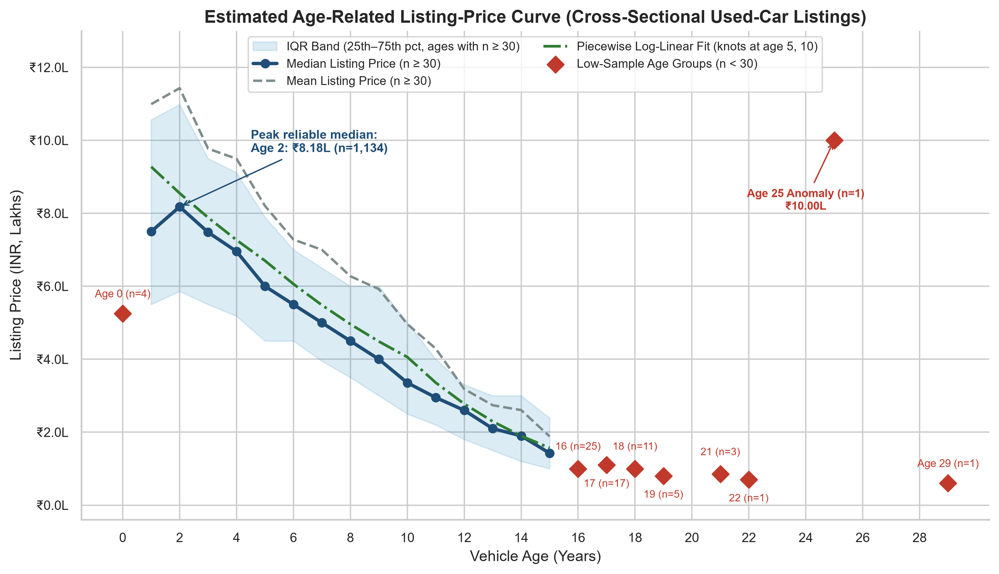
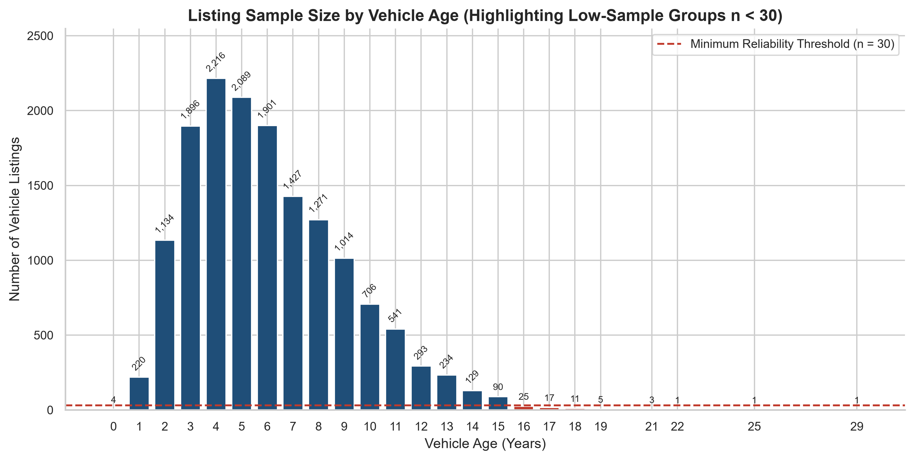
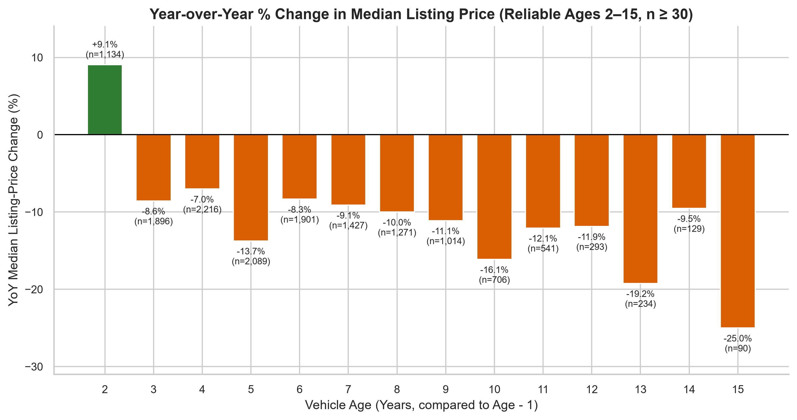

---

## 5. Solving the "Age-25 Anomaly" (`₹10.00 Lakh` Spike)

Why did the initial chart show a weird `₹10.00 Lakh` spike at `vehicle_age = 25`?

### What We Found
* **How many cars?** Literally **1 single car** (`row 15151`).
* **What car is it?** A **`Series 320d`** (BMW 3 Series, `model = "3"`), `Automatic`, `1,995 cc`, `154 bhp`, `50,000 km`, listed by an `Individual` seller for `₹10,00,000` (`₹10.00 Lakh`), and tagged as an `"SUV"`.
* **Why it's clearly a data error:**
  * Every nearby old car (`ages 21, 22, 29`) is an older budget car (Wagon R, City, Alto) selling for **`₹60,000 – ₹85,000`** — and ages `24` and `26` have **zero cars**.
  * Out of the **151 other BMW 3 Series** listings in the dataset, **none is older than 13 years** (typical age is `7` years, typical price `₹16.50L`). A 25-year-old 320d with `50k km` and a modern diesel engine doesn't fit reality, and `"SUV"` is also a wrong tag for a 3 Series sedan.

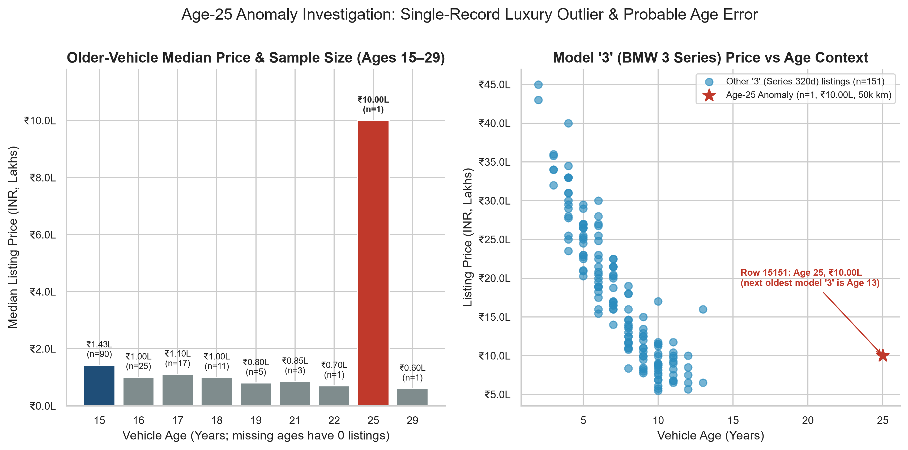

### What We Did About It
* **Keep it in `final_destination.csv` with a flag** so nobody loses track of where rows went.
* **Exclude it (along with all ages `< 30` cars) from our main charts and regression models**, which stops that one bad record from bending the tail of our price curve upward.

---

## 6. Automatic vs. Manual Price Difference by Body Type

Does buying/selling an Automatic add more value on an SUV, Sedan, Hatchback, or MUV?

We compared the **4 major body types** where both transmissions are common (`9,817` cars total; `5,317` `"Unknown"` and `95` rare body types were excluded so empty groups wouldn't skew results).

| Body Type | Manual Median (Count) | Auto Median (Count) | Raw Price Gap | **Fair Comparison Gap** *(Same Car & Specs)* |
| :--- | :---: | :---: | :---: | :---: |
| **Hatchback** | ₹4.25L (`3,240`) | ₹5.50L (`361`) | `+₹1.25L` (`+29.4%`) | **`+13.9%`** *(+11.8% to +16.0%)* |
| **Sedan** | ₹5.25L (`1,791`) | ₹11.25L (`1,048`) | `+₹6.00L` (`+114.3%`) | **`+16.8%`** *(+14.3% to +19.4%)* |
| **SUV** | ₹8.00L (`2,120`) | ₹14.50L (`699`) | `+₹6.50L` (`+81.3%`) | **`+14.8%`** *(+12.1% to +17.7%)* |
| **MUV** | ₹9.50L (`474`) | ₹18.00L (`84`) | `+₹8.50L` (`+89.5%`) | **`+9.6%`** *(+5.6% to +13.8%)* |

### Why the "Raw Gap" and "Fair Comparison" Are So Different
* **Don't trust the `+114%` raw Sedan gap:** In Sedans, SUVs, and MUVs, most Automatic cars in India are higher-end models or bigger-engine trims (for example, Automatic MUVs average `2,755 cc` vs. `2,494 cc` for Manuals). You're mostly seeing **bigger/fancier cars**, not just the gearbox.
* **The real gearbox premium is `~10% to 17%`:** Once we hold model, age, mileage, engine size, and seller constant, an Automatic adds **`+16.8%`** on Sedans, **`+14.8%`** on SUVs, **`+13.9%`** on Hatchbacks, and **`+9.6%`** on MUVs. The difference across body types is real (`p = 0.0354`), though the spread between segments is modest (`~7` percentage points).

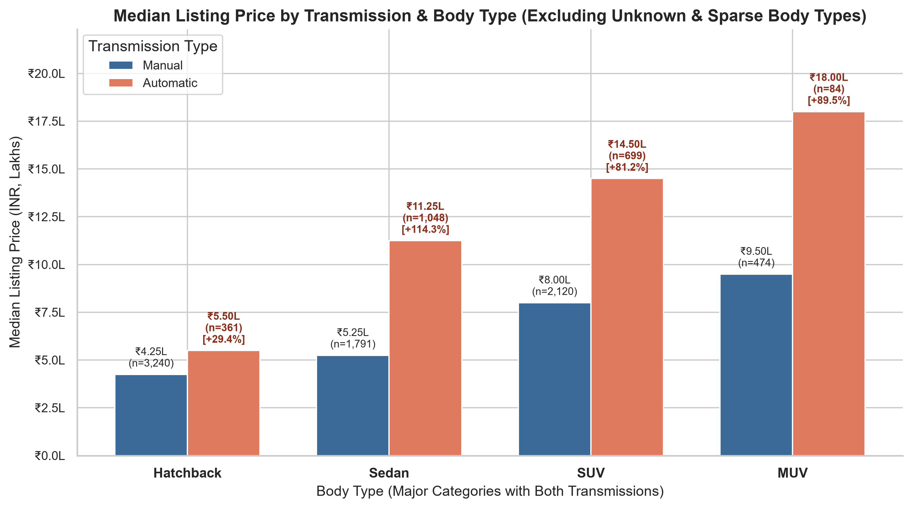
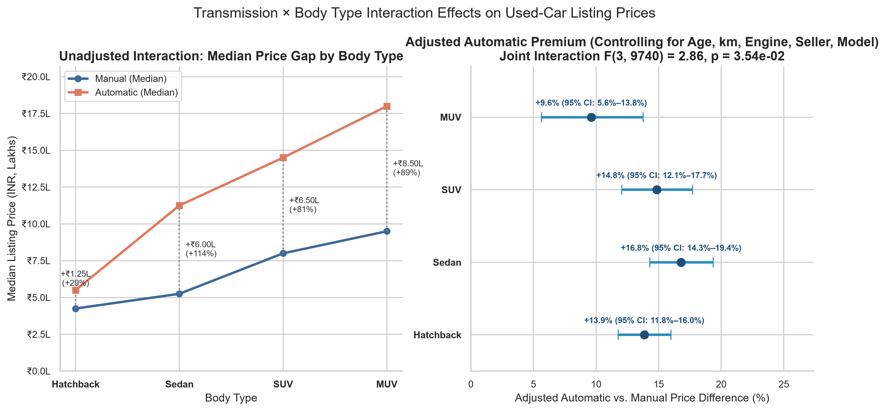

---

## 7. Dealer vs. Individual Seller Pricing & Inventory

*(Note: `Trustmark Dealer` has only `173` cars (`1.1%`), so we show it separately from standard Dealers.)*

### Side-by-Side Comparison

| What We Compared | Dealer (`9,446` cars) | Individual (`5,610` cars) | Trustmark Dealer (`173` cars, separate) |
| :--- | :---: | :---: | :---: |
| **Typical (Median) Price** | **₹5.90 Lakh** | **₹5.10 Lakh** | **₹5.40 Lakh** |
| **Average (Mean) Price** | ₹8.70 Lakh | ₹6.20 Lakh | ₹5.72 Lakh |
| **Middle 50% Price Range** | ₹4.11L – ₹8.90L | ₹3.50L – ₹7.30L | ₹4.10L – ₹6.75L |
| **Typical Age (Med / Avg)** | `6.0 yrs` / `6.15 yrs` | `5.0 yrs` / `5.92 yrs` | **`4.0 yrs` / `4.29 yrs`** *(newest)* |
| **Typical Km (Med / Avg)** | `50,000` / `52,478 km` | `50,000` / `59,672 km` | **`28,810` / `31,339 km`** *(lowest)* |
| **Share of Automatics** | **27.05%** | **10.09%** | **14.45%** |

### What Actually Drives the Price Gap?
1. **Unadjusted Difference:** Dealers list **`+15.69%` (`+₹80,000`) higher** than Individuals (`(₹5.90L / ₹5.10L - 1) × 100`).
2. **Why it's NOT just dealer markup:** Dealers aren't selling newer or lower-km cars (`median 6 yrs` vs. `5 yrs`, same `50,000 km`). Instead, Dealers stock **nearly 3× as many Automatics (`27.1%` vs. `10.1%`)** and more luxury vehicles (notice their average price `₹8.70L` sits far above their median `₹5.90L`).
3. **Like-for-Like Difference (`+5.66%`):** When we compare **identical models** with the same age, mileage, engine, body type, and transmission, Dealers still list **`+5.66%` higher** (`95% CI: +4.91% to +6.41%`). That `~5.7%` gap reflects showroom/warranty overhead and room to negotiate—**not** dealer profit (since we don't see what Dealers paid to acquire the car).
4. **Trustmark Dealers (`n = 173`):** Focus on newer (`4 yr`), low-mileage (`28.8k km`) mass-market cars, priced essentially in line with private sellers (`-2.76%` overall; `-0.22%`, `p = 0.91` on known major body types).

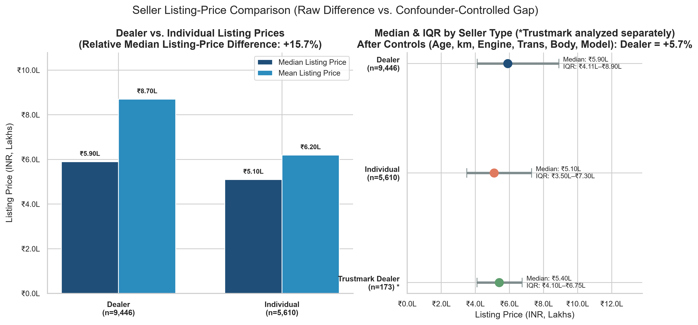
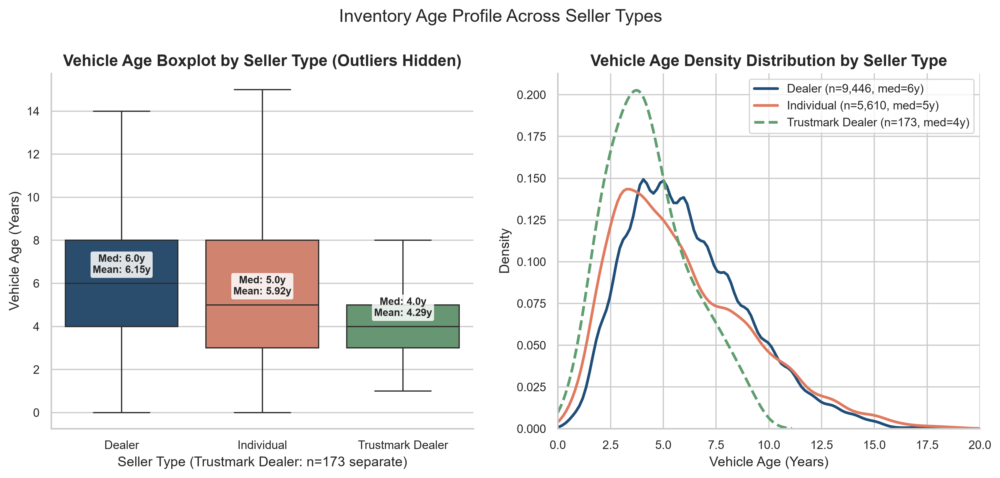
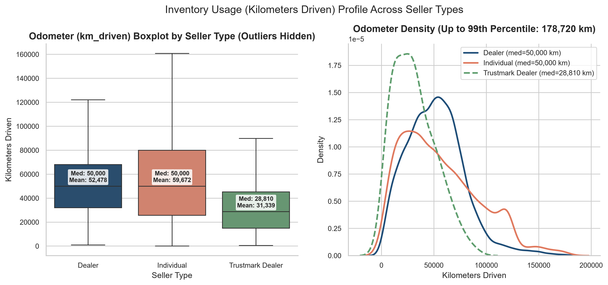
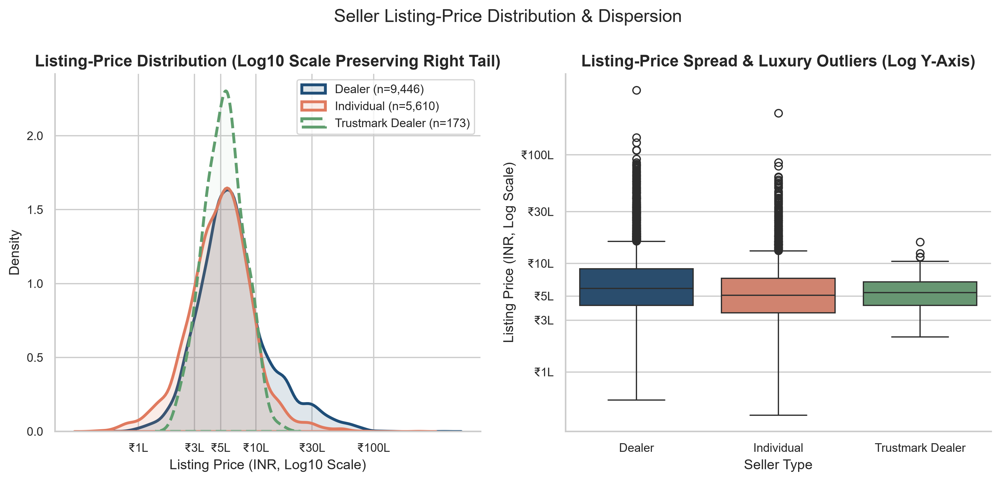

---

## 8. Statistical Tests (Are These Differences Real or Luck?)

Because car prices are heavily skewed by expensive luxury cars, we used **non-parametric tests** (which compare rankings/medians instead of assuming a bell curve) at a **`95%` confidence threshold (`α = 0.05`)**, with **Holm–Bonferroni** protection against false positives across multiple tests.

### Quick Summary of Every Test

| Question Tested | Test Used | Key Result & Effect Size | Plain-English Meaning |
| :--- | :--- | :--- | :--- |
| **Do Dealers price higher than Individuals?** | Mann–Whitney U | `U = 31.2M`, `p = 2.27e-74`, effect `r = +0.178`, diff `+₹80k` (`₹65k–₹98.5k`) | **Yes — real & noticeable.** Clearly higher Dealer listing prices. |
| **Do Dealers have different mileage (`km`)?** | Mann–Whitney U | `p = 2.13e-05`, effect `r = -0.041`, diff `0 km` | **Statistically different, practically identical.** With `15,000+` rows, even tiny tail differences trigger a small `p`-value, even though both medians equal `50,000 km`. |
| **Do Body Types (`Hatchback, Sedan, SUV, MUV`) differ in price?** | Kruskal–Wallis H + 6 pairwise tests | `H = 3,210.32`, `p < 1e-300`, effect `ε² = 0.327`; all 6 pairs `p <= 1.66e-12` | **Yes — large real market tiers:** Hatchback (`₹4.35L`) < Sedan (`₹6.25L`) < SUV (`₹8.80L`) < MUV (`₹10.78L`). |
| **Do Seller, Transmission, Body & Interaction matter together?** | Joint Wald F-tests (`HC3`) | Seller `F = 64.84` (`p = 1.1e-28`), Trans `F = 187.99` (`p = 2.2e-42`), Body `F = 1,661.24` (`p < 1e-300`), Interaction `F = 2.86` (`p = 0.0354`) | **Yes — all four contribute significantly** even after controlling for car model, age, km, and engine size. |

> **Key Rule:** A tiny `p`-value proves a difference isn't pure luck, **not** that it's big enough to care about (`km_driven` above is the perfect example). Always check the **effect size** (`₹` or `%` gap) alongside `p`.

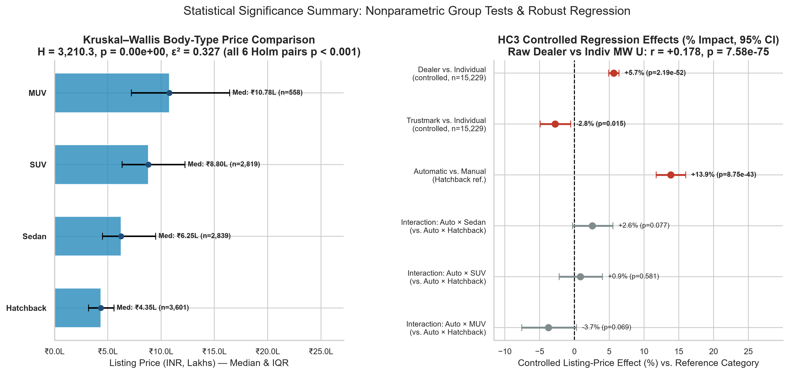

---

## 9. Regression Modeling (How We Isolated True Effects)

We tested several equations to explain listing prices fairly (`HC3` robust standard errors used so expensive luxury outliers don't distort confidence intervals):

### Step A: Modeling Price vs. Age Only (`n = 15,161`)
* **Straight-line (`Linear`) & Curves (`Polynomial`):** Poor fit (`R² = 0.057`), because cars lose a **percentage** of their value each year, not a fixed rupee amount.
* **Best Age-Only Model (`Piecewise Log-Linear` with bends at Age 5 & Age 10):** Best accuracy (`AIC = 27,367.3` vs. `27,507.6` for single-slope log-linear; `log R² = 0.227`, `MAE = ₹425,805`), capturing the steeper drop after Age 10 (`p = 7.02e-18`).

### Step B: Full Pricing Models (Controlling for Model, Age, Km, Engine, Power, Transmission, Body & Seller)
Adding what kind of car it actually is boosts price accuracy from `22.7%` (`R² = 0.227`) to **`92%` (`R² ≈ 0.92`)**:
* **Full Age-Control Model (`n = 15,161`, `R² = 0.9229`):** Each extra year lowers expected listing price by **`-10.60%`**.
* **Transmission × Body Model (`n = 9,817`, `R² = 0.9183`):** Confirms **`-11.64%/yr`** for age, **`-0.57%` per `10,000 km`**, **`+1.78%` per `100 cc`** engine size, and the **`+9.6%` to `+16.8%`** adjusted Automatic premiums.
* **Full Seller Model (`n = 15,229`, `R² = 0.9220`):** Confirms **`+5.66%`** Dealer listing premium (`p = 2.19e-52`) over Individuals for identical cars.

---

## 10. Key Findings Recap

1. **Expect ~`10.6%` annual percentage drop** on comparable cars, with a clear **Age-5 drop (`-13.7%`)**, a stable **Ages 6–9 sweet spot (`~₹0.50L/yr`)**, and an **Age-10 to 15 cliff (`-16.1%` to `-25.0%`)**.
2. **Never trust small-sample age tails (`n < 30`):** The Age-25 `₹10.00L` spike comes from `1` mis-aged BMW 320d.
3. **Compare apples to apples on Automatics:** Two-thirds to four-fifths of the raw Automatic price gap in Sedans/SUVs/MUVs is just luxury trim & engine size — the real gearbox bump is **`+9.6%` to `+16.8%`**.
4. **Dealer pricing isn't pure markup:** Only **`+5.66%`** of the `+15.69%` raw Dealer-vs-Individual gap remains after matching car specs and models; the rest comes from stocking **`2.7×` more Automatics** and higher-end vehicles.

---

## 11. Practical Business Recommendations

1. **Use the `+10%` to `+17%` rule when pricing Automatic trade-ins:** Price Automatics around **`+16.8%` (Sedan)**, **`+14.8%` (SUV)**, **`+13.9%` (Hatchback)**, and **`+9.6%` (MUV)** above the *same* Manual model—don't overpay based on unadjusted market medians.
2. **Time inventory buying & liquidation around Ages 6–9 and Age 10:**
   * **6–9 year cars** offer the steadiest annual resale value (`~₹0.50L/yr`).
   * **Age 9–10+ stock** should be discounted and turned quickly before hitting the `19%–25%` Age 13–15 drop.
3. **Justify the `~5.7%` Dealer price difference clearly:** Since private listings sit `~5.7%` lower for equivalent cars, Dealers should highlight inspection reports, warranties, and financing to win buyers.
4. **Add automatic data guardrails to Power BI & ML pipelines:** Flag `vehicle_age > 15`, `n < 30` cohorts, model-age mismatches (like row `15151`), and `"Unknown"` body types (`34.9%`) before publishing KPIs.

---

## 12. Limitations

1. **Asking prices, not sold prices:** Final negotiated prices and dealer purchase costs are unknown.
2. **Snapshot in time, not tracking one car:** Adjacent ages can vary slightly if one age group happens to contain more hatchbacks or SUVs (e.g., Age 1 vs. Age 2).
3. **`34.91%` missing body types:** `5,317` cars are labeled `"Unknown"` for `real_body_type`, though sensitivity tests confirm our seller findings stay consistent (`+5.42%` vs. `+5.66%`).
4. **Unseen vehicle condition & city:** Service history, accident records, and city/state location are not included in `final_destination.csv`.
5. **Thin data past Age 15:** Results should not be used to predict prices for cars older than `15` years or rare body styles (`Coupe`, `Sports`, `Pick-up`, `MPV`, `Crossover, SUV`).

---

## 13. Conclusion

Looking past surface averages reveals how India's used-car listings actually behave: **`~10.6%` annual depreciation** with a steady **6–9 year plateau**, an Age-25 spike caused by **one mis-aged BMW (`n=1`)**, a true **`+9.6%` to `+16.8%` Automatic premium**, and a **`+5.66%` like-for-like Dealer listing premium** driven largely by inventory mix rather than raw markup.
